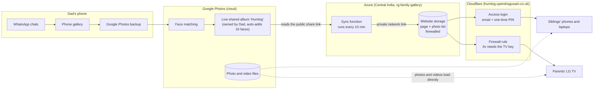

# Humlog: how it works

Humlog is a family photo slideshow for Mum and Dad's LG TV. Photos shared with them on WhatsApp end up in a Google Photos album. A small Azure job copies the album's photo list every 10 minutes, and the TV plays it, newest first. Nobody has to add, sync or refresh anything.

## The big picture

## Step by step

### 1. A photo reaches the album

1. Someone sends Mum or Dad a photo or video on WhatsApp, in the family group or a one-to-one chat.
2. WhatsApp saves it to the phone's gallery.
3. Google Photos on the phone backs it up to Dad's Google account.
4. Google's face matching recognises who is in it. This can take minutes to hours.
5. If it shows one of the 16 chosen faces, Google adds it to the live shared album **Humlog** automatically. This can also lag behind by a while.

### 2. The sync function copies the album's list (every 10 minutes)

An Azure Function (C#, .NET 10) wakes up every 10 minutes and:

1. **Publishes the web page.** It uploads any page files that have changed, so the page goes out even if Google is unreachable.
2. **Reads the album.** It opens the album's public share link, the same page a browser would see, and pages through it to collect every item: about 1,120 today.
3. **Checks new videos, once each.** It reads the start of each new video file:
   - Videos the TV can't stream are **left out**. These are huge phone originals that must be downloaded in full before they play.
   - Videos that phones recorded sideways are **flagged with their rotation**, so the TV can turn them upright.
4. **Builds the photo list** (`catalogue.json`), newest first.
5. **Publishes it safely:**
   - **Empty or much smaller lists are never published.** If the album suddenly reads as empty or far smaller (for example because Google changed its page), the old list stays.
   - **The previous list is kept** as `catalogue.prev.json`.
   - **Nothing is rewritten when the album hasn't changed.**

The photos and videos themselves are **not copied**. The list holds Google's own links to each file.

### 3. The website is locked down

- **One firewalled storage account:** the page and photo list live in a storage account that answers only two callers:
  - **Cloudflare**, which enforces the logins below.
  - **The sync function**, over a private network link.

  The raw Azure address answers "not found" to everyone else.
- **Cloudflare in front:** it sits in front as `humlog.upendragusain.co.uk` and provides HTTPS.
- **Two ways in:**

| Who | Address | How they get in |
|---|---|---|
| Siblings and family | `humlog.upendragusain.co.uk` | Cloudflare Access: enter an allowed email address, then the one-time PIN sent to it. Stays logged in for a month. |
| Parents' TV | `humlog.upendragusain.co.uk/tv/?key=…` | No login page. A Cloudflare firewall rule blocks any `/tv` request without the right key. The key is saved in the TV's bookmark and start page. |

### 4. The TV plays the slideshow

The page is plain, old-style JavaScript, because the TV's browser is old. It:

1. **Loads the photo list:**
   - Plays it **newest first**, then loops.
   - Shows photos for **8 seconds** each, with a crossfade.
   - Plays videos to the end.
2. **Loads each photo straight from Google at TV size:**
   - Fills the sides of portrait photos with a blurred copy.
   - Shows a photo only once it has fully loaded.
3. **Fixes sideways videos:** if the TV shows a phone video sideways, the page rotates it upright.
4. **Re-reads the list every 10 minutes.** New photos are played next, without a page reload.
5. **Skips anything that won't load** within 15 seconds.

## Remote control

| Button | What it does |
|---|---|
| Right / Left | Next / previous |
| OK, Play, Pause | Pause or resume ("Paused" shows on screen). If a video started muted, OK turns the sound on. |
| Up or Red | Start again from the newest photo |
| Magic Remote pointer | Click left third = previous, right third = next, middle = pause |

The observed key codes are recorded in [tv-remote.md](tv-remote.md).

## Where everything lives

| Piece | Where |
|---|---|
| Album | Google Photos live album "Humlog", owned by Dad's account |
| Sync function | Azure `func-family-gallery-e085b6` (Flex Consumption, Central India) |
| Function's own storage (code package, video-check results) | Azure `stfamgallerye085b6` |
| Website storage (page + photo list) | Azure `sthumloge085b6`, firewalled |
| Private network link | Azure `vnet-family-gallery` / `snet-func` |
| Domain, logins, TV key rule | Cloudflare: DNS record `humlog`; Access apps `humlog` (family policy) and `humlog/tv` (bypass); Security rule "Humlog TV key" |
| Code | `poc/sync` (function), `poc/web` (page), `poc/sync.Tests` (tests), `poc/infra` (deploy / delete scripts) |
| Detailed spec | [spec-azure-poc.md](../spec-azure-poc.md) |

**Secrets are never kept in the code or in git:**
- the album's share link: Azure app setting `ALBUM_SHARE_URL`
- the TV key: only in the Cloudflare rule and the TV's bookmark

## Looking after it

| Task | How |
|---|---|
| Deploy a code change | Run `poc/infra/deploy.ps1`. The function publishes the new page within about 10 minutes. |
| Point at a different album | Run `poc/infra/deploy.ps1 -ShareUrl <new share link>` |
| Change the TV key (e.g. if it leaked) | Edit the Cloudflare rule "Humlog TV key" with a new key, then update the TV's bookmark and start page. |
| Add or remove a family member | Cloudflare Zero Trust → Access → Applications → humlog → the `family` policy's email list |
| Delete everything in Azure | Run `poc/infra/teardown.ps1` (Cloudflare items are removed separately) |
| Running cost | About £0–2 a month |

## Known limits

- **Unofficial reading of the album:** Google offers no supported way to read a shared album, so the sync reads its public share page. If Google changes that page, new photos stop appearing, but the TV keeps playing the last good list until the code is updated.
- **Some videos are left out:** large phone originals can't play directly. Making TV-sized copies is the planned fix ("Phase B" in the spec).
- **New photos take time to arrive:** most of the delay is Google's face matching and album updates, before the sync can see them.
- **Family logins expire monthly:** siblings log in again every month. The TV's key never expires.
- **Photo links aren't private:** Google's links to the photo files work for anyone who has them. The firewall and login keep the photo *list* private, which is what stops strangers finding them.
